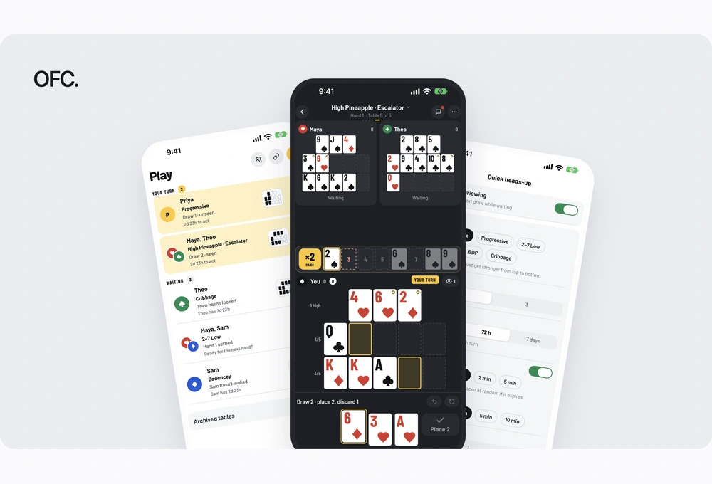
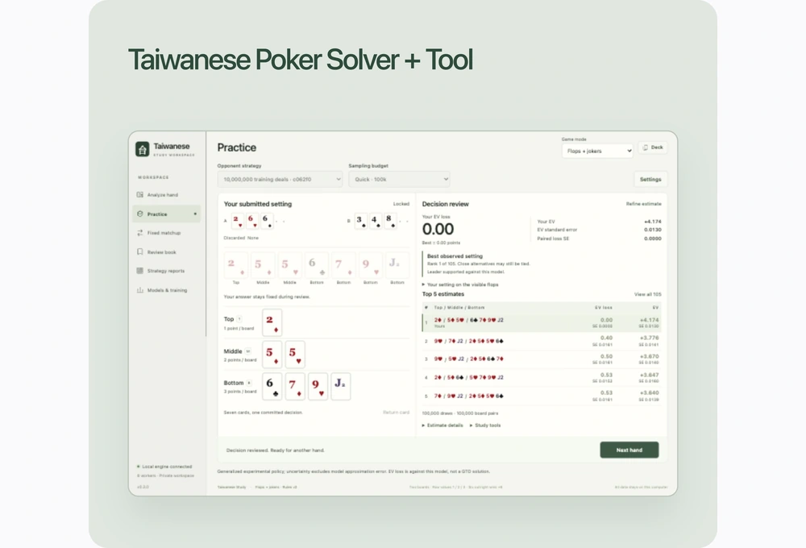
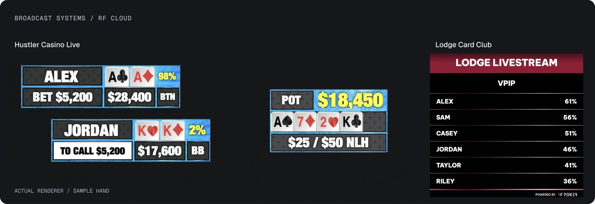

<a href="https://jgil325.github.io">
  <picture>
    <source media="(prefers-color-scheme: dark) and (max-width: 600px)" srcset="./assets/hero-cycle-mobile-dark.svg">
    <source media="(max-width: 600px)" srcset="./assets/hero-cycle-mobile-light.svg">
    <source media="(prefers-color-scheme: dark)" srcset="./assets/hero-cycle-dark.svg">
    <source media="(prefers-color-scheme: light)" srcset="./assets/hero-cycle-light.svg">
    
  </picture>
</a>

  <a href="https://jgil325.github.io">Portfolio</a> &nbsp; · &nbsp;
  <a href="https://jgil325.github.io/work/">Work</a> &nbsp; · &nbsp;
  <a href="https://www.linkedin.com/in/gil-jacob/">LinkedIn</a> &nbsp; · &nbsp;
  <a href="mailto:jacobgil325@gmail.com">Email</a>

I’m Jacob, a **Product Lead & Engineer at RF Labs**. I build thoughtful software, from mobile products for live events to the graphics that bring the action on air.

**Built with** &nbsp; `React Native` · `TypeScript` · `Rust` · `Tauri` · `Supabase` · `Next.js`

## Selected work

  
  

**[OFC Mobile ↗](https://jgil325.github.io/work/ofc-mobile/)** 
Multiplayer poker, from the rules engine to the last interaction. 
React Native / Expo / TypeScript

**[Taiwanese Poker Solver + Tool ↗](https://jgil325.github.io/work/taiwanese-study/)** 
A desktop workspace for better poker decisions. 
Rust / React / Tauri

**[Live broadcast graphics ↗](https://jgil325.github.io/work/broadcast-graphics/)** 
Real-time data and animated overlays for Hustler Casino Live and Lodge Card Club. 
RF Cloud / Lead Engineer / RF Labs · Renderer previews use sample data.

**[Hand History Recorder ↗](https://jgil325.github.io/work/hand-history-recorder/)** 
Capture the hand. Review every decision. 
React / TypeScript / PWA

**[Card Vendor Tracker ↗](https://jgil325.github.io/work/card-vendor-tracker/)** 
Inventory, sales, and the numbers behind a card business. 
React / Supabase

Also in the library: **[OiStir](https://jgil325.github.io/work/oistir/)**, a team exploration of audio and language; **[Weekly Slopmeter](https://jgil325.github.io/work/weekly-slopmeter/)**, adapted from [JeanMeijer/slopmeter](https://github.com/JeanMeijer/slopmeter); and **[Vanilla Chat](https://jgil325.github.io/work/vanilla-chat/)**, an early team collaboration.

## I like the whole problem.

The product decisions. The interface details. The architecture underneath. I care about how they fit together.

I lead product and frontend work at RF Labs, pairing interface design with hands-on engineering. Previously, I led engineering for RF Cloud.

**[Have something in mind? ↗](mailto:jacobgil325@gmail.com)** &nbsp; [Resume](https://jgil325.github.io/resume/) &nbsp; · &nbsp; [Explore the full portfolio](https://jgil325.github.io)
